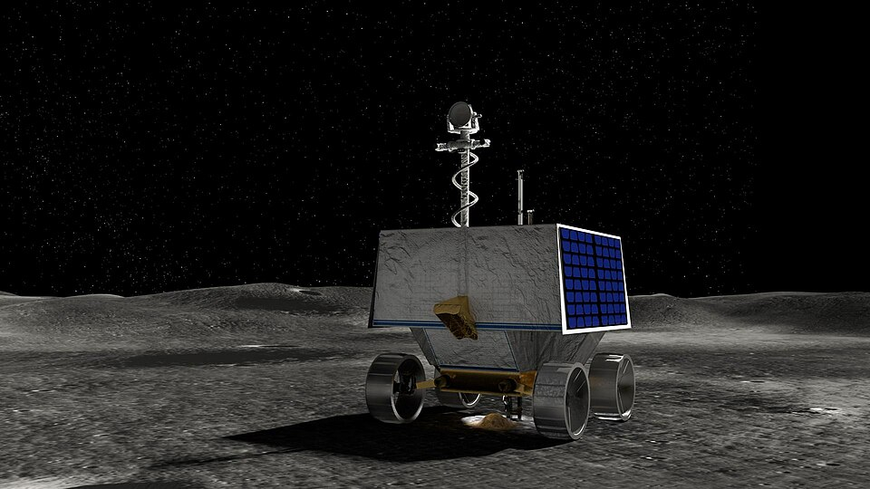

# APOLLOGISTICS
Lunar Landing Site Navigator

**Tell us what your rover can survive. We'll tell you when and where it can land on the Moon, and then let you stand there.**

<a href="https://appologists-lunar-navigator.netlify.app/"></a>

Team Apollogistics' project for the NASA Space Apps Challenge 2026 (Seattle), challenge
[Lunar Landing Site Navigator](https://www.spaceappschallenge.org/2026/challenges/lunar-landing-site-navigator/).

**Try it now:** <https://appologists-lunar-navigator.netlify.app/> (or scan the code). Nothing to install.
The hosted copy runs the ready-made missions; for everything else, [run it yourself](#run-it-yourself) in about two minutes.

## Why we built this

On 6 March 2025 a lander called Athena reached the Moon's south pole after a trip of more than a million
kilometres. It came down about 250 metres from its target, on its side, in a crater. From there it could
see the Earth. It could not see the Sun. Its batteries lasted under 13 hours of a mission planned for 10 days.

No planning tool fixes a bad landing, and ours would not have saved Athena. But that story is the south
pole in one picture. The water ice everyone wants is there because some ground never sees the Sun. A rover
needs the Sun to stay alive. A few hundred metres, or a few days' slip in the launch, decides which of the
two you get.

Most tools show you the sky for a place and date you already picked. We turned the question round.

## What you can do with it

1. **Describe the mission.** How long the rover survives in the dark, how accurately the lander can land,
   how steep it can drive. NASA's VIPER rover is one click: it cannot endure more than 50 hours of darkness.
2. **See which regions can take it.** Seven candidate regions near the south pole are searched on real NASA
   terrain. The list says which ones pass your rules, and why the others do not.
3. **Ask "When can you land?"** Every landing hour for the next 30 days is tried at each region's best
   spots: up to 15,120 landings. You get the best hour, a 30-day strip with the reason for each bad day, and
   an estimate of solar power for a panel you describe.
4. **Plan the drive.** The map shows where the rover can reach and suggests a route, then plays the trip back
   with the Sun moving and the shadows with it.
5. **Stand there.** Street view puts you on the surface at the landing spot: real terrain, real shadows, the
   Sun and Earth where they would be. It works in a Meta Quest headset too.


<sub>VIPER, the rover our ready-made mission is built around. Artist's concept: NASA Ames / Daniel Rutter.</sub>

## What is real in here

| | |
| --- | --- |
| **The ground** | NASA's LOLA laser altimeter on the Lunar Reconnaissance Orbiter: 80 m across the south pole, 5 m at four landing regions. |
| **The sky** | Sun and Earth positions are worked out in your browser and agree with NASA JPL Horizons to about 0.004°. The Sun's disc is 0.53° wide, so that is under a hundredth of it. |
| **The horizon** | For each spot we build the real skyline from the terrain, every half degree of compass direction, out to 300 km. A ridge 100 km away can hide the Sun, and here it does. |
| **The checks** | About 290 automated tests, plus commands that compare our answers with JPL Horizons and with a slower point-by-point method (see the table below). |

## What it does not claim

We would rather tell you this ourselves.

- **"Passes your rules" is not "safe".** A site passes when every point inside the landing accuracy passes every
  check you set. Rocks and craters smaller than the map are invisible to us.
- **Earth in view means a direct radio link is possible, not guaranteed.** Antennas, transmitter power and
  ground-station schedules are not checked.
- **Solar power is an estimate** for the panel you describe. It leaves out dust, heat and ageing.
- **It checks every hour, not every minute**, and only the 30 days you ask about. "Not seen in 30 days" is
  not "never".
- **The older ranked list of 23 known sites** (behind `?tools`) still assumes a smooth Moon. The finder and
  everything in the mission steps use real terrain.

How we word things on screen, and why: [docs/wording.md](docs/wording.md).

## Run it yourself

You need [Node.js](https://nodejs.org/) 22.12 or newer (`node --version` to check).

```bash
npm install
npm run data:fetch -- lola-south-80s-80m   # south-pole terrain, 115 MB, kept out of git
npm run dev
```

Open the address it prints (normally <http://localhost:5173>). "Plan a mission" opens first: take the Pre-set
mission, then follow the tabs along the top: **Moon**, **Site**, **Street view**, **Ride**.

Going to show it to people? [docs/demo-runbook.md](docs/demo-runbook.md) takes about 15 minutes and makes
each region's search take about a second.

<details>
<summary><b>Sharper street view, VR, the website build and the older tools</b></summary>

For the sharpest street view (5 m ground at Connecting ridge, Shackleton rim, the peak near Shackleton and
Malapert), also get NASA Goddard's 5 m maps (387 MB). Without them the street view uses the 80 m data and says so.

```bash
npm run data:fetch -- pgda-lola-5mpp
```

**VR on a Meta Quest, no hosting:** `npm run dev:quest`, then open the address it prints in the Quest's
browser (same Wi-Fi; tap "Advanced" > "Proceed" on the certificate warning).

**The website (no server):** the hosted site is the same app reading saved answers instead of the server.
With the app running:

```bash
npm run export:static
npm run build:site
```

Then upload the `dist` folder to Netlify. Missions with other settings say they are not saved on the website;
they work when the app runs on a computer.

**The older tools** (ranked list of 23 sites, weights, terrain data, the one-click JPL Horizons check) are off
the page for the demo: add `?tools` to the address.

</details>

| Command | What it does |
| --- | --- |
| `npm run dev` | Runs the app with live reload |
| `npm test` | Runs the tests (about 2 seconds) |
| `npm run check:horizons` | Compares our Sun and Earth maths with JPL Horizons over the next 28 days |
| `npm run check:landing` | Compares the landing-site finder with the slower point-by-point method at 16 places |
| `npm run data:light` | Stores the seven regions' sunlight and Earth maps (5 min, 344 MB), so searches take about a second |
| `npm run check:light` | Checks that a search using the stored maps gives exactly the computed answer |
| `npm run demo:warm` | With the app running: asks every search the ready-made missions need, so the steps open at once |
| `npm run data:list` | Lists the large datasets we know about and which ones you have |
| `npm run data:fetch -- <id>` | Downloads one into `data/raw/` (never committed) |
| `npm run build` | Builds a static copy into `dist/` |

## Where things are

| Path | What |
| --- | --- |
| `index.html`, `src/main.js` | The page, and the file that wires everything together |
| `src/astro/` | Sun and Earth positions, the sky from a site, the JPL Horizons client |
| `src/terrain/` | Terrain around a point: the real horizon, and the format terrain travels in |
| `src/finder/` | The landing-site finder and "When can you land?": the rules, the results map, the date scan |
| `src/surface/` | The view from the ground, and its shadows |
| `src/globe/` | The 3D Moon |
| `src/criteria/`, `src/scoring/` | The older ranked list: one file per thing a site is scored on, and the ranking |
| `src/ui/` | The mission steps (`flow.js`), panels and cards |
| `server/` | Runs inside the dev server: reads the big terrain files and serves the piece the app asks for |
| `data/` | Ready-made missions, curated sites and the dataset catalogue, each entry with its source |
| `tools/` | Command-line helpers: dataset download, the checks above |
| `lunar-planner/` | A second front end that runs with Python only (Flask): see its README |
| `education/` | The learning pages that ship with the website |
| `tests/` | Tests, including reference values from JPL Horizons |
| `docs/` | Plan, decisions, architecture, how-tos |

Want to add something? Start with [docs/plan.md](docs/plan.md) and [docs/decisions.md](docs/decisions.md).
Adding a way to score sites: [docs/adding-a-criterion.md](docs/adding-a-criterion.md). Using a big dataset:
[data/README.md](data/README.md). Working with an AI coding tool: it should read [AGENTS.md](AGENTS.md) first.

## How we built it

One weekend, in a browser: JavaScript, [three.js](https://threejs.org/) for the Moon and the surface,
[Astronomy Engine](https://github.com/cosinekitty/astronomy) for where the Sun and Earth are, and
[Vite](https://vite.dev/) to hold it together. Coordinates use the Moon's mean-Earth / polar-axis frame, the
same one LRO maps and Horizons use. The details and the assumptions are in [docs/architecture.md](docs/architecture.md).

We used AI coding tools to help write the code. We did not take their word for the maths: every position
is checked against NASA JPL Horizons, and the finder, the date scan and the power estimate each have their own tests.

## The team

Khiem Hoang Tran · Prasiddha (Nick) · Thanh Minh Nguyen · Rishi Jasuja · Karley Browning · Daniel Blackburn · Patrick

## Credits

- **Terrain:** NASA Lunar Reconnaissance Orbiter, LOLA laser altimeter (NASA Planetary Data System, Geosciences
  Node), and NASA Goddard's 5 m south-pole maps.
- **Moon colour map:** NASA's Scientific Visualization Studio, [CGI Moon Kit](https://svs.gsfc.nasa.gov/4720/),
  from Lunar Reconnaissance Orbiter data. Public domain.
- **Reference ephemeris:** [NASA JPL Horizons](https://ssd.jpl.nasa.gov/horizons/).
- **Libraries:** [Astronomy Engine](https://github.com/cosinekitty/astronomy) by Don Cross (MIT),
  [three.js](https://threejs.org/) (MIT), [Vite](https://vite.dev/) and Vitest (MIT).
- **Landing regions and site coordinates:** see the `sources` sections of `data/missions.json` and `data/sites.json`.
- **Mission-card pictures** (`public/images/`): NASA artist's concepts, public domain, via Wikimedia Commons:
  [Starship HLS](https://commons.wikimedia.org/wiki/File:HLS_Starship_rendering.jpg) and
  [VIPER](https://commons.wikimedia.org/wiki/File:Viper-ACD20-0047.jpg) (NASA Ames, Daniel Rutter).
  `janky-rover.svg` is our own drawing, and we are fond of it.

*Nobody should lose a mission to a shadow they could have seen coming.*
