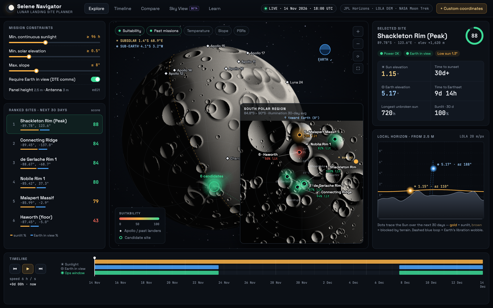
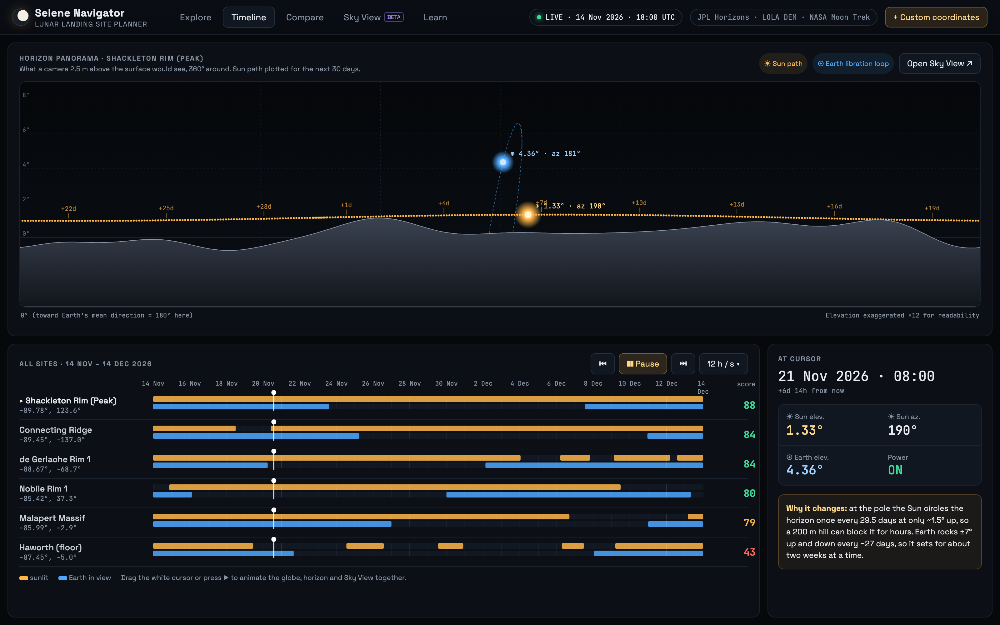
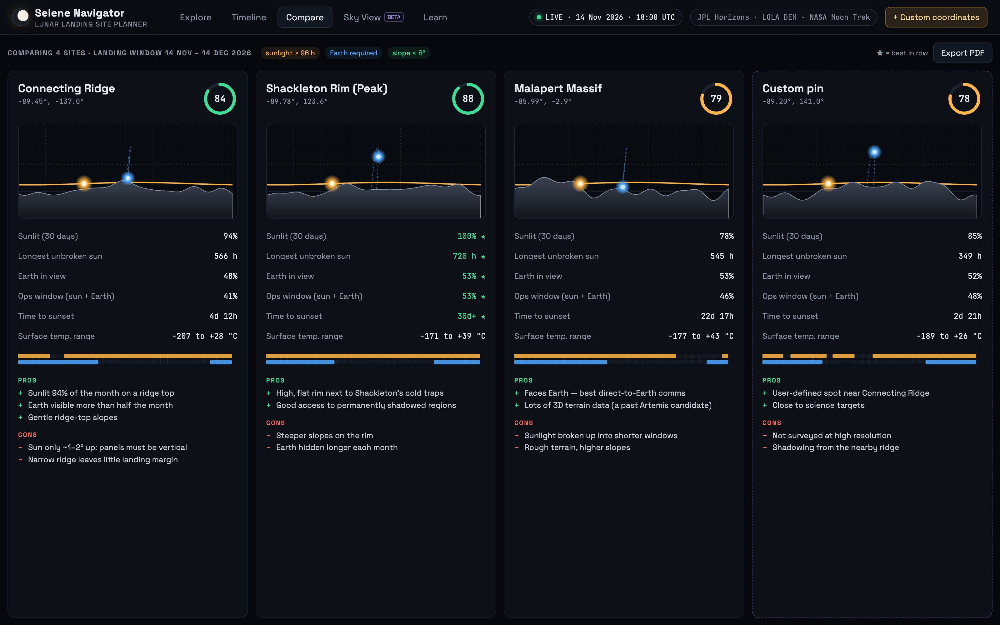

# UI mockups

Design ideas for the app's main screens, made on 14 November 2026 to help the team agree on a look. They
are pictures, not the app: nothing here is wired to `src/`.

> **The numbers in these images are made up.** Site coordinates are real (see `data/sites.json`), but every
> sunlight %, Earth %, score, time-to-sunset and temperature was generated from fake terrain so the layout
> looks believable. Do not quote them, and do not copy them into the app (rule 1 in `AGENTS.md`).

| File | What |
| --- | --- |
| `1-explore.png` | Front page: 3D Moon, south-pole close-up, ranked sites, selected-site card, timeline strip |
| `2-timeline.png` | 360° horizon panorama with 30 days of Sun path, and sunlight / Earth bars for every site |
| `3-compare.png` | Sites side by side, including a custom pin, with pros and cons |
| `mockup.html` | The page the images were taken from. Open it with `?view=explore`, `?view=timeline` or `?view=compare`. It is a throwaway sketch and breaks the code rules (it uses `innerHTML`), so borrow ideas, not code. |

## Explore (front page)

- Left: mission constraints (minimum unbroken sunlight, minimum Sun elevation, maximum slope, Earth must be
  in view, panel and antenna height) and the ranked site list. Thin bars under each site show sunlit % in
  gold and Earth-in-view % in blue.
- Centre: the globe with past landers (Apollo, Luna 24, Chandrayaan-3) and the day/night line. A close-up of
  the south pole (84.8°S–90°S) shows the candidate sites, coloured by score, because they are too close
  together to tell apart on the globe.
- Right: the selected site's Sun and Earth elevation, time to sunset and Earthset, longest unbroken sunlight,
  and a small horizon chart.
- Bottom: a timeline of sunlight, Earth in view and "ops window" (both at once) for the next 30 days.

## Timeline

- A 360° horizon as seen from the panel height. Dots trace the Sun over the next 30 days: gold when lit,
  brown when the terrain blocks it. The dashed blue loop is Earth's monthly wobble (libration).
- Below, the same 30 days for every site, with a cursor you drag. The globe, horizon and sky view would all
  follow the same cursor.
- A short "why it changes" box for the public: the Sun circles the polar horizon about 1.5° up, so a small
  hill can block it for hours; Earth rises and sets about every two weeks.

## Compare

- Three or four sites side by side: score, horizon chart, metrics with the best value in each row starred,
  30-day sunlight and Earth bars, pros and cons.
- A dashed card for the user's own pin.

## How the mockups map to `docs/plan.md`

| Mockup feature | Plan item |
| --- | --- |
| Horizon chart with terrain, Sun blocked by hills | #1 terrain pipeline, #2 real horizons |
| Max-slope slider | #3 landing terrain |
| Temperature range in Compare | #6 temperature (label it as an estimate) |
| Past landers on the globe | #7 better site list |
| Compare screen | #8 side-by-side comparison |
| Timeline with draggable cursor | #9 date comparison |
| Constraints panel with sliders and toggles | #10 must-haves, not just weights |
| South-pole close-up | Later: polar map / 2D polar map |
| Green glow on the globe | Later: shaded "good zones" |
| "Sky View (beta)" tab | Stretch: sky view |

## Notes from the review (Claude, 14 November 2026)

Feedback on the plan and the challenge text, written when the mockups were made.

**Is it possible?** Yes, and it fits the challenge closely. The brief asks for almost exactly this:
compare sites and dates, show where the Sun and Earth sit against the horizon, show time left before sunset
and Earthset, add a timeline view, and make it usable by non-experts. The judges' "why not just use
Horizons?" question is the gap the challenge itself describes, so "accessibility" is the right answer.

**Things to keep in mind**

- **Focus on the south pole.** The challenge stresses it, and that is where ranking by *unbroken* sunlight
  matters most. At the pole the Sun circles the horizon only 1–2° up, so one hill can block it for hours.
- **The terrain horizon is the hard part.** Horizons (and Astronomy Engine) say where the Sun and Earth are
  in the sky. They do not know whether a mountain is in the way. That needs a horizon line from LOLA terrain
  (plan items #1 and #2).
  - Shortcut if time is short: precompute the horizon for a handful of fixed sites with a script in `tools/`,
    and keep the smooth-Moon horizon (with its caveat) for custom pins.
- **Don't call Horizons live for every site.** Browser requests can be blocked (CORS) and rate-limited.
  The app already computes positions locally with Astronomy Engine and checks them against Horizons, which
  is the right approach.
- **What to cut if time runs short:** Sky View and temperature. The minimum demo is the Explore and Timeline
  screens with real numbers.
